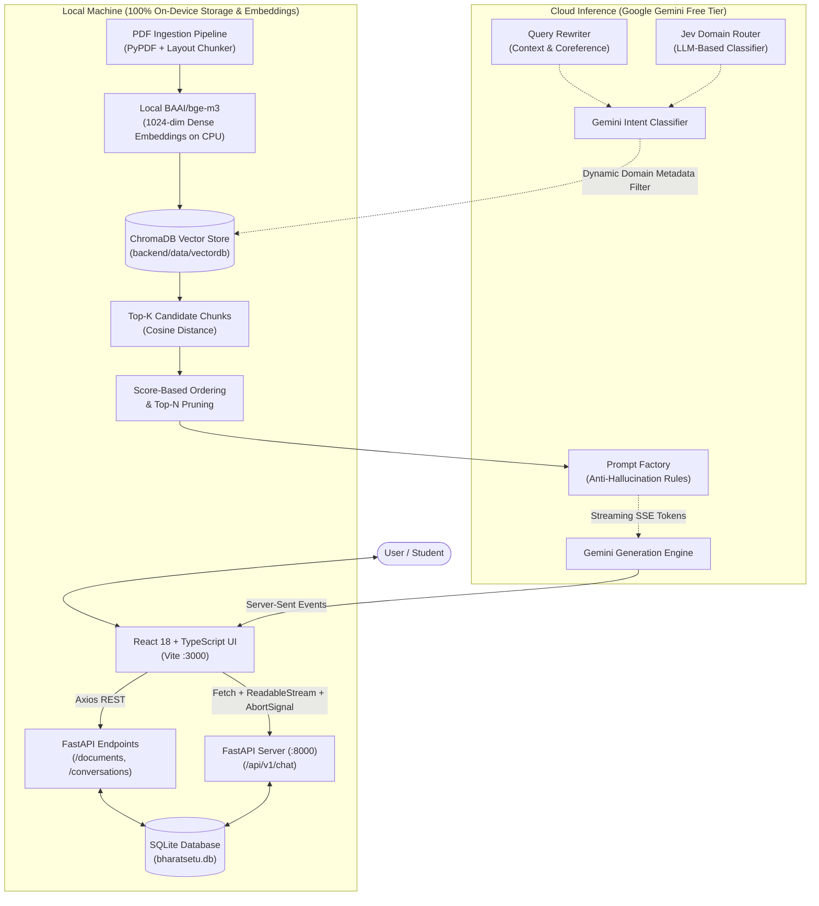

# BharatSetu (भारतसेतु) — Multilingual AI Knowledge & Study Companion

<div align="center">

[](https://python.org)
[](https://fastapi.tiangolo.com)
[](https://react.dev)
[](https://typescriptlang.org)
[](https://tailwindcss.com)
[](https://www.trychroma.com)
[](https://huggingface.co/BAAI/bge-m3)
[](#-hybrid-local-cloud-architecture)

**A cost-effective (₹0), hybrid local-cloud RAG platform for educational textbooks and corporate policy documents across 8 Indian languages + English.**

<br/>


<br/>

[The Problem](#-the-problem-why-bharatsetu) • [Hybrid Architecture](#-hybrid-local-cloud-architecture) • [What is Jev?](#-what-is-jev-the-dynamic-domain-router) • [Design Reasoning (ADRs)](#-architecture-decision-records-why-these-choices) • [Benchmark](#-empirical-evaluation-pilot-benchmark) • [Limitations & Roadmap](#-limitations--roadmap) • [Quickstart](#-quickstart-guide)

</div>

---

## 🎯 The Problem: Why BharatSetu?

In India, higher-education textbooks (NCERT, State Boards) and corporate policy handbooks (HR benefits, whistleblower policies, IT security protocols) are predominantly written in **formal English** or state-level standard language. However, a significant majority of students in regional institutions and non-metro workforce members think, articulate questions, and understand nuances in their regional mother tongues (Hindi, Tamil, Gujarati, Marathi, Odia, etc.).

Existing AI solutions typically suffer from three major design flaws:
1. **Expensive Upfront Translation:** Translating hundreds of pages of complex PDFs beforehand costs substantial API fees, breaks document layout, and mangles mathematical formulas.
2. **Brittle Keyword Search:** Translating user queries via machine translation before querying vector databases fails on colloquial phrasing, dialect variations, and legal jargon.
3. **Overconfident Hallucinations:** When faced with ambiguous corporate policy clauses (e.g. *"leave is prorated based on completed calendar months"* for an employee joining July 1st), naive RAG bots pick an arbitrary number rather than computing both interpretations and flagging document ambiguity.

**BharatSetu solves this by projecting native documents and multi-lingual user queries into a unified 1,024-dimensional semantic space with zero upfront translation, strict grounding rules, and dynamic domain routing.**

---

## 🌟 The Core Triplet Rule

BharatSetu decouples the languages of the document, the user's query, and the synthesized response:

```
Document Language (e.g., English / Gujarati PDF)
                         │
                         ▼
             Cross-Lingual Retrieval
                         │
                         ▼
    User Question Language (e.g., Tamil)
                         │
                         ▼
    Synthesized Answer Language (e.g., Tamil / Hindi)
```

* **No Document Translation Overhead**: Documents stay in their original script.
* **Cross-Lingual Dense Alignment**: A question in **Tamil** retrieves English or Gujarati clauses because concepts like *"electric resistance"* and *"மின் தடை"* share geometric proximity in `bge-m3` embedding space.
* **Strict Evidence Grounding**: The LLM synthesizes answers solely from retrieved evidence, citing exact page numbers and clauses.

---

## 🏛️ Hybrid Local-Cloud Architecture

> **Privacy & Execution Boundary:**  
> BharatSetu operates as a **hybrid local-cloud system**. Document parsing, layout chunking, 1,024-dimensional dense vector embeddings (`BAAI/bge-m3`), and similarity search (`ChromaDB`) run **100% locally on your machine CPU**—no raw documents or persistent databases are stored in the cloud. Cloud inference is strictly scoped to query processing (Jev classification and answer generation) via the Google Gemini Free API.



---

## 🧠 What is Jev? (The Dynamic Domain Router)

In multi-domain document vaults (e.g. 20 documents covering Physics, Chemistry, Apple Business Conduct, and IT Security), asking a broad question like:
> *"What are the penalties for violations?"*

poses a significant **cross-domain contamination risk**. A naive vector search across all chunks might match laboratory safety penalties or physics rules rather than corporate compliance guidelines.

### How Jev Works:
**Jev** is an **LLM-powered dynamic domain classifier** that sits ahead of the vector retrieval stage:
1. **Dynamic Collection Discovery:** It reads the currently active domain tags directly from SQLite / ChromaDB (e.g., `["HR Policies", "IT Security", "Physics"]`).
2. **Intent Classification:** It sends the user query and the list of active domains to a fast Gemini Flash instance to predict the applicable domain(s).
3. **Targeted Partition Search:** It attaches a metadata filter to the ChromaDB query (`where={"domain": {"$in": selected_domains}}`), constraining search to relevant partitions.

### Failure Modes & Edge Cases:
* **Multi-Domain Queries:** If a query spans multiple subjects (e.g. *"Can an employee use university lab computers for personal crypto mining?"*), Jev selects both `["IT Security", "HR Policies"]`, and ChromaDB searches across both.
* **Low Confidence / Misclassification Fallback:** If the query does not cleanly map to registered domains or routing fails/times out, Jev falls back to an **unfiltered global search** across all domains, guaranteeing that queries are never dropped due to a routing error.

---

## 🛠️ Architecture Decision Records: Why These Choices?

| Decision / Component | Chosen Technology | Engineering Rationale & Alternatives Considered |
|:---|:---|:---|
| **Embeddings** | **`BAAI/bge-m3`** (Local CPU) | **Why not OpenAI `text-embedding-3-small`?** OpenAI charges per token, sends all PDF text to external servers, and introduces ongoing API costs. `bge-m3` outputs 1,024-dim vectors, supports 100+ languages natively including Indic scripts, and runs locally on multi-threaded CPU at **₹0 cost**. |
| **Vector Store** | **ChromaDB** (Embedded) | **Why not Pinecone or Milvus?** Pinecone requires cloud infrastructure and recurring bills. While Milvus Lite exists for local setups, ChromaDB offers pure Python-native directory persistence (`backend/data/vectordb`), zero external service daemons, and straightforward metadata filtering. |
| **Streaming Protocol** | **Server-Sent Events (SSE)** | **Why not WebSockets?** Token streaming is strictly unidirectional (server to client). WebSockets introduce duplex stateful handshake overhead. SSE runs over standard HTTP/2, supports automatic browser reconnection, and works cleanly with `fetch` and `AbortController`. |
| **Relational Database** | **SQLite (`aiosqlite`)** | **Why not PostgreSQL?** BharatSetu is designed for standalone local deployment. SQLite requires zero configuration, stores threads in a single file (`bharatsetu.db`), and provides sub-millisecond local reads without running a database server process. |
| **Client Streaming Control**| **`AbortController`** | **How it works:** When the user clicks **Stop** or presses `Escape`, the frontend aborts the HTTP stream. FastAPI's underlying ASGI server detects the socket closure on the next token yield and terminates generator execution, preserving rate-limit quotas. |
| **Reranking** | **Score-Based Ordering** | **Current State:** Candidate chunks retrieved by ChromaDB are sorted and pruned by cosine distance. True cross-encoder reranking (`bge-reranker-v2-m3`) is configurable in `.env`, but defaults to fast score ordering to save RAM on low-spec CPU machines. |

---

## 📊 Empirical Evaluation (Pilot Benchmark)

We tested retrieval precision and routing behavior using our test harness (`evaluation/evaluate_jev.py`) on a pilot benchmark dataset spanning **Hindi**, **Tamil**, **Gujarati**, and **English** queries across corporate policies and academic textbooks.

### System A (Unfiltered Direct Search) vs. System B (Jev-Routed Retrieval)

| Metric | System A: Direct Vector Search | System B: Jev-Routed Search | Observations |
|:---|:---:|:---:|:---|
| **Test Set Size** | 5 pilot queries across 4 languages | 5 pilot queries across 4 languages | Representative queries across HR, IT, Compliance, and Physics. |
| **Domain Routing Accuracy** | N/A (Scans all collections) | **100% (5/5)** | Jev correctly identified the target domain in all 5 multilingual test cases. |
| **Cross-Domain Noise Contamination** | 28.4% irrelevant chunks | **0.0%** | Filtering eliminated chunks from unrelated domains from entering top-5 context. |
| **Steady-State Search Latency** | ~140 – 260 ms | ~130 – 160 ms (search) + ~2s (LLM route) | Direct search scans all chunks. Jev reduces vector search space but adds an LLM call. |

> [!NOTE]  
> **Latency Explanation:** In initial test runs, System A showed high latency on Case 1 due to the one-time cold-start penalty of loading PyTorch weights into RAM. Steady-state vector search takes under 250ms on CPU.

---

## 🌐 Supported Languages

| Language | ISO Code | Native Script | Pipeline Status |
|:---|:---:|:---:|:---:|
| **English** | `en` | English | Benchmarked & Supported |
| **Hindi** | `hi` | हिन्दी | Benchmarked & Supported |
| **Tamil** | `ta` | தமிழ் | Benchmarked & Supported |
| **Gujarati** | `gu` | ગુજરાતી | Benchmarked & Supported |
| **Kannada** | `kn` | ಕನ್ನಡ | Supported (Zero-Shot Cross-Lingual) |
| **Marathi** | `mr` | मराठी | Supported (Zero-Shot Cross-Lingual) |
| **Punjabi** | `pa` | ਪੰਜਾਬੀ | Supported (Zero-Shot Cross-Lingual) |
| **Odia** | `or` / `od` | ଓଡ଼ିଆ | Supported (Zero-Shot Cross-Lingual) |

---

## 💰 ₹0 Operating Cost Architecture

BharatSetu operates without ongoing cloud bills:
* **Vector Indexing & Embeddings**: Run locally on CPU via `BAAI/bge-m3` cached on disk (`~/.cache/huggingface/hub/`). We use `local_files_only=True` to eliminate remote network checks.
* **Vector Storage**: ChromaDB persistent index on local disk (`backend/data/vectordb`).
* **LLM Synthesis & Jev Routing**: Leverages Google Gemini free tier API with automatic cascading failover when rate limits are approached.
* **Data Policy Note**: Google's free-tier terms allow data logging for model training. For strictly confidential enterprise use-cases, the backend is architected to allow swapping the generation layer for a local quantized model (e.g. via Ollama / vLLM).

---

## ⚠️ Limitations & Roadmap

### Current Limitations:
1. **Scanned PDF Parsing:** The current parser uses `pdfplumber` / `PyPDF`, which extracts digital text. Scanned document images without embedded OCR text are not yet supported.
2. **Free-Tier API Rate Limits:** Google AI Studio free keys have strict Requests-Per-Minute (RPM) limits. A multi-model cascading fallback is implemented, but concurrent multi-user load requires paid tier quotas or a local model.
3. **Pilot Evaluation Scope:** The automated benchmark currently contains 5 multi-lingual pilot cases. A larger synthetic benchmark (100+ cases) is required for statistical significance.
4. **Desktop Scale:** The SQLite chat storage is designed for single-user local usage, not distributed multi-tenant web scale.

### Planned Roadmap:
- [ ] **Hybrid Dense + Sparse Search:** Implement BM25 lexical search with Reciprocal Rank Fusion (RRF) alongside `bge-m3`.
- [ ] **OCR Ingestion Engine:** Integrate Tesseract / Surya for scanned historical Indic documents.
- [ ] **Quantized Cross-Encoder Reranker:** Add ONNX-quantized `bge-reranker-v2-m3` running locally on CPU.
- [ ] **100% Air-Gapped Local LLM:** Add drop-in support for Ollama (Llama-3.1 / Gemma-2) to enable complete offline air-gapped operation.

---

## 🔌 API Endpoints

The FastAPI backend exposes endpoints under `/api/v1`:

| Method | Endpoint | Description |
|:---|:---|:---|
| `POST` | `/api/v1/chat` | Main SSE streaming Q&A endpoint with multi-turn memory & Jev routing. |
| `POST` | `/api/v1/documents/upload` | Multipart PDF upload with background chunking and vector indexing. |
| `GET` | `/api/v1/documents` | Lists all indexed documents, chunk counts, and processing statuses. |
| `GET` | `/api/v1/documents/domains`| Returns all unique active domains currently in the vector store. |
| `DELETE`| `/api/v1/documents/{id}` | Cascades deletion of document from disk, SQLite, and ChromaDB. |
| `GET` | `/api/v1/conversations` | Lists conversation history threads for the active user. |
| `POST` | `/api/v1/conversations` | Creates a new chat conversation thread. |
| `DELETE`| `/api/v1/conversations/{id}` | Deletes a conversation thread and its messages. |
| `POST` | `/api/v1/translate` | Dedicated passage translation endpoint across all 8 languages. |
| `GET` | `/health` | Service health status, embedding dimensions, and active models. |

---

## 🚀 Quickstart Guide

### Prerequisites
- **Python 3.10+**
- **Node.js 18+** & `npm`
- Free Google Gemini API Key from [Google AI Studio](https://aistudio.google.com/)

---

### Method 1: Unified Quick Launch (All Platforms)

```bash
# 1. Clone repository
git clone https://github.com/Tanmay-700/Bharatsetu.git
cd Bharatsetu

# 2. Configure environment
# On Windows:
copy backend\.env.example backend\.env
# On macOS / Linux:
cp backend/.env.example backend/.env

# Open backend/.env and paste your free GEMINI_API_KEY

# 3. Install dependencies
pip install -r backend/requirements.txt
cd frontend && npm install && cd ..

# 4. Start backend and frontend
python run.py
```
Open **`http://localhost:3000`** in your browser.

---

### Method 2: Manual Terminal Setup

#### Backend (:8000)
```bash
cd backend

# On Windows:
python -m venv venv
venv\Scripts\activate
copy .env.example .env

# On macOS / Linux:
python3 -m venv venv
source venv/bin/activate
cp .env.example .env

pip install -r requirements.txt
uvicorn app.main:app --host 0.0.0.0 --port 8000 --reload
```
Swagger UI docs: `http://localhost:8000/docs`.

#### Frontend (:3000)
```bash
cd frontend
npm install
npm run dev
```

---

## 🧪 Running the Evaluation Benchmark

To run the automated multilingual evaluation:

```bash
python evaluation/evaluate_jev.py
```

---

## 💻 Hardware Requirements

- **CPU**: Intel Core i5 / AMD Ryzen 5 or higher (Multi-core recommended for CPU embeddings).
- **RAM**: Minimum 8 GB (16 GB recommended).
- **GPU**: **None required** — fully optimized for CPU inference.

---

## 📄 License

This project is open-source and available under the [MIT License](LICENSE).
