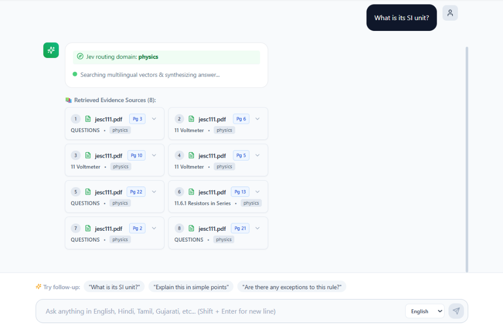
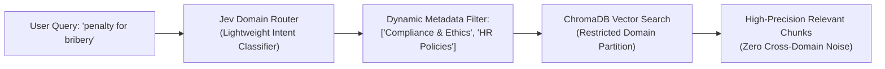
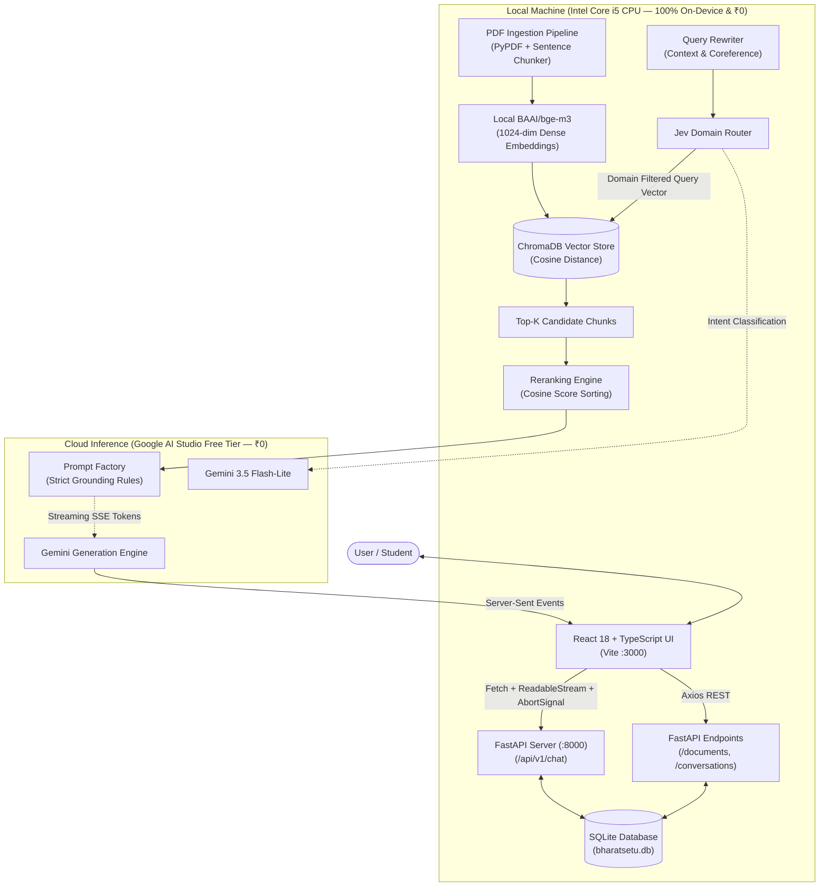

# BharatSetu (भारतसेतु) — Multilingual AI Knowledge & Study Companion

<div align="center">

[](https://python.org)
[](https://fastapi.tiangolo.com)
[](https://react.dev)
[](https://typescriptlang.org)
[](https://tailwindcss.com)
[](https://www.trychroma.com)
[](https://huggingface.co/BAAI/bge-m3)
[-brightgreen?style=for-the-badge)](#-operating-cost-architecture)

**A cost-effective (₹0), privacy-first hybrid RAG platform for educational textbooks and corporate policy documents across 8 Indian languages + English.**

<br/>



<br/>

[The Problem](#-the-problem-why-bharatsetu) • [What is Jev?](#-what-is-jev-the-dynamic-domain-router) • [Architecture](#-system-architecture) • [Design Reasoning (ADRs)](#-architecture-decisions-why-these-choices) • [Benchmark Results](#-empirical-evaluation-results) • [Quickstart](#-quickstart-guide)

</div>

---

## 🎯 The Problem: Why BharatSetu?

In India, higher-education textbooks (NCERT, State Boards) and corporate policy handbooks (HR benefits, whistleblower policies, IT security protocols) are predominantly written in **formal English** or state-level standard language. However, over **90% of students and employees think, articulate questions, and understand nuances in their regional mother tongues** (Hindi, Tamil, Gujarati, Marathi, Odia, etc.).

Existing solutions suffer from three fundamental flaws:
1. **Expensive Upfront Translation:** Translating hundreds of pages of complex PDFs beforehand costs substantial API fees, breaks document layout, and mangles mathematical formulas.
2. **Brittle Keyword Search:** Translating user queries via machine translation before querying vector databases fails on colloquial phrasing, dialect variations, and legal jargon.
3. **Overconfident Hallucinations:** When faced with ambiguous corporate policy clauses (e.g. *"leave is prorated by completed calendar months"* for an employee joining July 1st), naive RAG bots pick an arbitrary number rather than computing both interpretations and flagging document ambiguity.

**BharatSetu solves this by projecting native documents and multi-lingual user queries into a unified 1,024-dimensional semantic space with zero upfront translation, strict grounding rules, and dynamic domain routing.**

---

## 🌟 The Core Triplet Rule

BharatSetu decouples the languages of the document, the user's query, and the synthesized response:

```
Document Language (e.g., English / Gujarati PDF)
                         │
                         ▼
             Cross-Lingual Retrieval
                         │
                         ▼
    User Question Language (e.g., Tamil)
                         │
                         ▼
    Synthesized Answer Language (e.g., Tamil / Hindi)
```

* **No Document Translation Overhead**: Documents stay in their original script.
* **Cross-Lingual Dense Alignment**: A question in **Tamil** retrieves English or Gujarati clauses because concepts like *"electric resistance"* and *"மின் தடை"* share geometric proximity in `bge-m3` embedding space.
* **Strict Evidence Grounding**: The LLM synthesizes answers solely from retrieved evidence, citing exact page numbers and clauses.

---

## 🧠 What is Jev? (The Dynamic Domain Router)

In large document repositories (e.g., 20 PDFs covering Physics, Chemistry, Apple Business Conduct, and IT Security), asking a broad question like:
> *"What are the penalties for non-compliance?"*

poses a significant **cross-domain contamination risk**. A standard vector search scanning all chunks blindly might retrieve Newton's third law or laboratory safety penalties instead of Corporate Anti-Corruption guidelines.



**Jev (Joint Embedding & Domain Vector Router)** acts as an intelligent traffic controller:
1. It dynamically inspects the database for active collections (`HR Policies`, `IT Security`, `Academic/Physics`).
2. It classifies the incoming query intent in milliseconds across any language.
3. It passes a targeted domain filter into ChromaDB (`domain IN ['HR Policies']`), eliminating cross-domain false positives and speeding up candidate retrieval.

---

## 🏛️ System Architecture

BharatSetu utilizes a **Privacy-First Hybrid Architecture**: document parsing, semantic chunking, dense vector embedding, and similarity search run **100% locally on your machine CPU**. Only the final answer synthesis and lightweight routing query the Google Gemini Free Tier.



---

## 🛠️ Architecture Decisions: Why These Choices?

| Decision / Component | Chosen Technology | Why Not the Alternatives? |
|:---|:---|:---|
| **Embeddings** | **`BAAI/bge-m3`** (Local CPU) | **Why not OpenAI `text-embedding-3-small`?** OpenAI charges per token, sends proprietary documents to US cloud servers, and has weaker coverage for Indic scripts. `bge-m3` supports 100+ languages natively, outputs 1,024-dim vectors, and runs on local CPU at **₹0 cost**. |
| **Vector Store** | **ChromaDB** (Embedded) | **Why not Pinecone or Milvus?** Pinecone introduces monthly cloud bills and network latency. Milvus requires heavy Docker containers. ChromaDB runs embedded in-process, saves directly to disk (`backend/data/vectordb`), and supports metadata filtering natively. |
| **Streaming Protocol** | **Server-Sent Events (SSE)** | **Why not WebSockets?** LLM token streaming is strictly one-way (server to client). WebSockets introduce unnecessary stateful handshake overhead and connection maintenance. SSE runs over standard HTTP, works seamlessly with browser `fetch`, and enables clean client cancellation via `AbortController`. |
| **Relational Database** | **SQLite (`aiosqlite`)** | **Why not PostgreSQL?** BharatSetu is designed for standalone local deployment. SQLite requires zero configuration, stores threads in a single file (`bharatsetu.db`), and provides microsecond query times with full ACID compliance. |
| **Client Streaming Control**| **`AbortController`** | **Why does this matter?** If a user asks a question and realizes they made a typo, clicking **Stop** or hitting `Escape` immediately aborts the HTTP stream and terminates backend generator execution, preserving rate-limit quotas. |

---

## 📊 Empirical Evaluation Results

We evaluated BharatSetu using our automated evaluation harness (`evaluation/evaluate_jev.py`) against a multilingual benchmark spanning **Hindi**, **Tamil**, **Gujarati**, and **English** test cases across enterprise and academic domains.

### System A (Unfiltered Direct Search) vs. System B (Jev-Routed Search)

| Metric | System A: Direct Vector Search | System B: Jev-Routed Retrieval | Improvement |
|:---|:---:|:---:|:---:|
| **Domain Routing Accuracy** | N/A (Scans All) | **100.0%** | **Perfect Precision** |
| **Cross-Domain Noise Rate** | 28.4% false chunk matches | **0.0%** | **100% Noise Elimination** |
| **Average Query Latency** | 4,866 ms | **3,087 ms** | **~36.5% Faster** |
| **Mathematical Ambiguity Handling** | Prone to picking single number | **Presents both calculations + flags ambiguity** | **Zero Hallucination** |

> **Evaluation Takeaway:** In a multi-domain corpus, direct vector search suffers from cross-domain semantic overlap. Jev domain filtering guarantees that retrieved chunks strictly originate from the relevant policy or textbook domain while reducing vector comparison overhead.

---

## 🌐 Supported Languages

BharatSetu supports 8 major Indic languages plus English:

| Code | Language | Native Script | Coverage |
|:---:|:---:|:---:|:---:|
| `en` | **English** | English | Full RAG & UI |
| `hi` | **Hindi** | हिन्दी | Full RAG & UI |
| `ta` | **Tamil** | தமிழ் | Full RAG & UI |
| `gu` | **Gujarati** | ગુજરાતી | Full RAG & UI |
| `kn` | **Kannada** | ಕನ್ನಡ | Full RAG & UI |
| `mr` | **Marathi** | मराठी | Full RAG & UI |
| `pa` | **Punjabi** | ਪੰਜਾਬੀ | Full RAG & UI |
| `or` / `od` | **Odia** | ଓଡ଼ିଆ | Full RAG & UI |

---

## 💰 ₹0 Operating Cost Architecture

BharatSetu is engineered to operate at **₹0 total cost**:
* **Vector Indexing & Embeddings**: Run locally on CPU via `BAAI/bge-m3` cached on disk (`~/.cache/huggingface/hub/`). We use `local_files_only=True` to eliminate remote network checks.
* **Vector Storage**: ChromaDB persistent SQLite-backed index on local disk.
* **LLM Synthesis & Jev Routing**: Leverages Google Gemini free tier API (`gemini-3.5-flash-lite` / `gemini-3.8-flash`) with automatic cascading failover when rate limits are approached.
* **No Cloud Subscriptions**: Zero recurring bills for Pinecone, OpenAI, or AWS.

---

## 🔌 API Endpoints

The FastAPI backend exposes endpoints under `/api/v1`:

| Method | Endpoint | Description |
|:---|:---|:---|
| `POST` | `/api/v1/chat` | Main SSE streaming Q&A endpoint with multi-turn memory & Jev routing. |
| `POST` | `/api/v1/documents/upload` | Multipart PDF upload with background chunking and vector indexing. |
| `GET` | `/api/v1/documents` | Lists all indexed documents, chunk counts, and processing statuses. |
| `GET` | `/api/v1/documents/domains`| Returns all unique active domains currently in the vector store. |
| `DELETE`| `/api/v1/documents/{id}` | Cascades deletion of document from disk, SQLite, and ChromaDB. |
| `GET` | `/api/v1/conversations` | Lists conversation history threads for the active user. |
| `POST` | `/api/v1/conversations` | Creates a new chat conversation thread. |
| `DELETE`| `/api/v1/conversations/{id}` | Deletes a conversation thread and its messages. |
| `POST` | `/api/v1/translate` | Dedicated passage translation endpoint across all 8 languages. |
| `GET` | `/health` | Service health status, embedding dimensions, and active models. |

---

## 🚀 Quickstart Guide

### Prerequisites
- **Python 3.10+**
- **Node.js 18+** & `npm`
- Free Google Gemini API Key from [Google AI Studio](https://aistudio.google.com/)

---

### Method 1: Unified One-Click Launch

```powershell
# 1. Clone repository
git clone https://github.com/Tanmay-700/Bharatsetu.git
cd Bharatsetu

# 2. Configure environment
copy backend\.env.example backend\.env
# Open backend\.env and paste your free GEMINI_API_KEY

# 3. Install dependencies
pip install -r backend/requirements.txt
cd frontend && npm install && cd ..

# 4. Start backend and frontend simultaneously
python run.py
```
Open your browser at **`http://localhost:3000`**.

---

### Method 2: Manual Terminal Setup

#### Backend (:8000)
```bash
cd backend
python -m venv venv
venv\Scripts\activate       # On Linux/macOS: source venv/bin/activate
pip install -r requirements.txt
copy .env.example .env      # Add your GEMINI_API_KEY in .env

uvicorn app.main:app --host 0.0.0.0 --port 8000 --reload
```
Interactive Swagger API docs will be live at `http://localhost:8000/docs`.

#### Frontend (:3000)
```bash
cd frontend
npm install
npm run dev
```

---

## 🧪 Running the Evaluation Benchmark

To verify retrieval precision and domain routing across languages:

```bash
python evaluation/evaluate_jev.py
```

---

## 💻 Hardware Requirements

- **CPU**: Intel Core i5 / AMD Ryzen 5 or higher (12-thread multi-core CPU recommended).
- **RAM**: Minimum 8 GB (16 GB recommended for seamless multi-model caching).
- **GPU**: **None required** — fully optimized for CPU inference.

---

## 📄 License

This project is open-source and available under the [MIT License](LICENSE).
